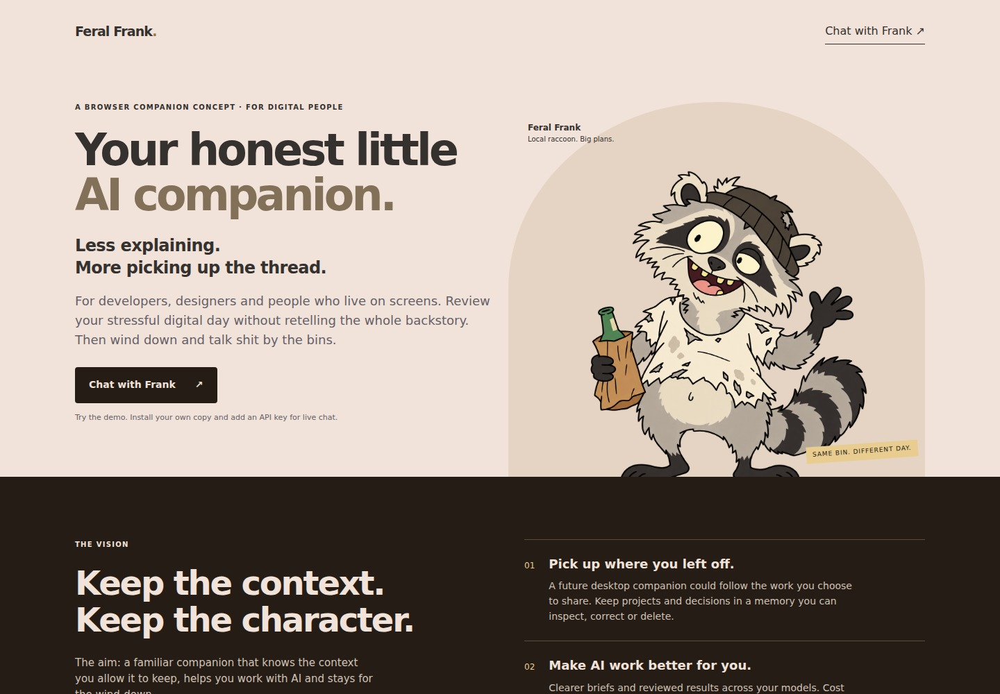
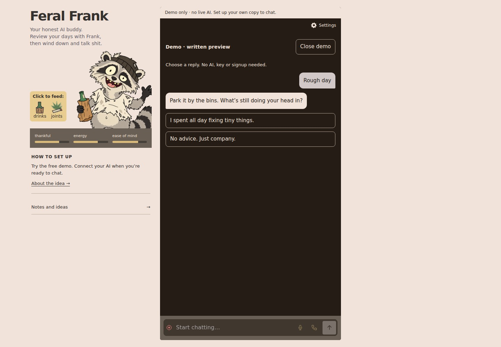

# Feral Frank

**Your honest AI buddy. Review your day. Then talk shit by the bins.**

A browser companion concept for developers, designers and digital people. Less repeated explaining, with a character you enjoy spending time with. Your AI provider, editable memory, original Frank personality.

## About Frank

<a href="https://konradbuilds.github.io/feral-frank/" target="_blank" rel="noopener">About Frank →</a>

## Chat with Frank

<a href="https://konradbuilds.github.io/feral-frank/app.html" target="_blank" rel="noopener">Chat with Frank →</a>

**Demo only:** scripted chat, feeding reactions and character settings. Install your own copy to connect live AI. Never enter a key in the public demo. GitHub controls whether README links open a new tab.

## Install your own copy

### On your computer

1. Choose **Code → Download ZIP**, then unzip.
2. Install [Node.js](https://nodejs.org/) (20+). Open Terminal in the folder and run `node bridge/server.mjs`.
3. Open **http://127.0.0.1:8811**. In Settings, choose a provider, add your API key and select **Save key**.

Keep Terminal open; Ctrl+C stops the server. Localhost works over HTTP. Opening app.html directly gives only the demo.

### On your PHP hosting

1. Upload the app to PHP 8.1+ hosting with cURL and mbstring, using HTTPS.
2. Place your private password configuration outside the public web folder and repository.
3. Open `frank.php`, sign in, then connect your API key in Settings.

[Full installation and troubleshooting guide →](SETUP.md)

API keys are separate from ChatGPT/Claude subscriptions. Free tiers have limits; paid usage is billed by your provider.

## What this is

Original cartoon companion, feeding reactions, connected text chat, editable local memory, notes and storage controls. Adjust his reply length, humour, roughness and how opinionated he is. Automatic learning and day-long context capture are future ideas, not delivered features. Memory is stored information, not model training.

Publish only clean source. Never commit real passwords, API keys, private configuration or chat exports. GitHub Pages serves the backend-free `docs/` folder; your private installation runs separately.

[Product vision](PRODUCT_VISION.md) · [GPL v3](LICENSE.txt) · Made by [Konrad Sroka](https://konradbuilds.github.io/)

## Frank’s character

Settings → Frank’s character: reply length, humour, roughness and opinion. One Frank, no modes. For bigger decisions he helps you weigh facts and trade-offs; the choice stays yours. AI behaviour varies by model.

[Character design](CHARACTER_ROADMAP.md) · [Parked calls](VOICE-ROADMAP.md)
